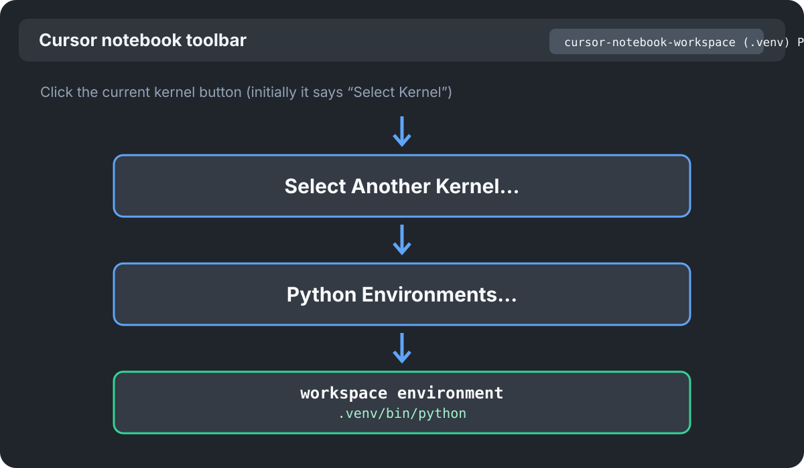

# Notebook runbooks

This folder contains three complete workflows. They share the same project dependency files but have different execution locations:

| Notebook | Kernel/function location | Use it for |
| --- | --- | --- |
| local_pytorch.ipynb | Mac .venv kernel | Learning, MPS, CPU |
| remote_cuda.ipynb | Remote Linux .venv kernel | CUDA, Triton, nvcc, profiling |
| modal_functions.ipynb | Local kernel; remote function container | Discrete remote GPU calls |

## One-time Cursor setup

Install these Cursor extensions:

- Python (ms-python.python)
- Jupyter (ms-toolsai.jupyter)
- Remote - SSH (anysphere.remote-ssh)

Open the project:

```bash
cd ~/Developer/ml-lab
uv sync
cursor -r .
```



The hermetic kernel flow is:

```text
current kernel name / Select Kernel
  -> Select Another Kernel...
  -> Python Environments...
  -> .venv/bin/python
```

The kernel starts automatically when you run the first code cell. There is no separate kernel-start command in the normal Cursor workflow. Confirm startup when the toolbar shows the selected environment, the cell receives an execution number such as [1], and the first output prints sys.executable inside .venv.

Do not use the Command Palette's Jupyter: Manage Access To Jupyter Kernels; it manages extension access and is not the notebook kernel picker.

## Local PyTorch: local_pytorch.ipynb

### Setup

```bash
cd ~/Developer/ml-lab
uv sync
cursor -r .
```

### Run

1. Open local_pytorch.ipynb from the Explorer.
2. Select the project .venv/bin/python using the kernel flow above.
3. Click Run All.

The first cell starts the local Python kernel and verifies its executable, Python version, PyTorch version, and device. The remaining cells test matrix multiplication, autograd, and inline plotting.

### Stop

Use the notebook Restart menu to reset Python state, or close Cursor to end the local kernel. Saved notebook outputs remain in the .ipynb; variables in memory do not.

## Remote SSH + CUDA: remote_cuda.ipynb

### Requirements

- A Linux host with an NVIDIA GPU.
- SSH access from the Mac.
- An NVIDIA driver and a working nvidia-smi command.
- uv installed on the remote host.
- A remote checkout of this repository.

Add the host locally:

```sshconfig
Host gpu-box
    HostName YOUR_GPU_HOST
    User YOUR_REMOTE_USER
    IdentityFile ~/.ssh/id_ed25519
```

Test it:

```bash
ssh gpu-box
nvidia-smi
```

### Prepare the remote checkout

Run on the remote host:

```bash
cd ~/Developer
git clone YOUR_REPOSITORY_URL ml-lab
cd ~/Developer/ml-lab
uv sync
nvidia-smi
uv run python -c "import torch; print(torch.cuda.is_available(), torch.cuda.get_device_name(0))"
```

There is no automatic file synchronization. Cursor opens and edits the remote checkout directly.

### Run in Cursor

1. Run Remote-SSH: Connect to Host....
2. Choose gpu-box.
3. Open the remote ml-lab folder.
4. Open remote_cuda.ipynb.
5. Select the remote .venv/bin/python using Select Another Kernel... -> Python Environments....
6. Click Run All.

The first cell starts the remote kernel and requires CUDA. The notebook intentionally fails instead of falling back to CPU or MPS.

### Stop and release resources

Commit or push code, close the notebook, disconnect Remote SSH, and stop or terminate the GPU instance with its provider. Closing Cursor alone does not stop a rented machine.

## Modal function calling: modal_functions.ipynb

### Setup

```bash
cd ~/Developer/ml-lab
uv sync --extra remote
uv run modal setup
```

Authentication is stored outside this repository. Never commit Modal credentials.

### Run

1. Keep Cursor connected to the local ml-lab folder.
2. Open modal_functions.ipynb.
3. Select the local .venv/bin/python using the kernel flow above.
4. Run the first cell: this starts the local notebook kernel and loads Modal.
5. Run the second cell: this defines the remote GPU function locally.
6. Run the final cell: this calls the function on a Modal T4 GPU.

The final call is billable. It returns the remote CUDA device, GPU name, and result shape. Modal handles the remote container lifecycle; there is no persistent remote notebook kernel to shut down.

## Kernel versus server versus function

- A notebook kernel is a running Python process holding cell state in memory.
- A Jupyter server manages notebook connections and starts kernels.
- Cursor normally starts both pieces as needed.
- A Modal function call is a separate remote execution; it is not the same as a persistent notebook kernel.

## Checks

```bash
cd ~/Developer/ml-lab
uv run pytest
uv run ruff check .
uv run ruff format --check .
```
